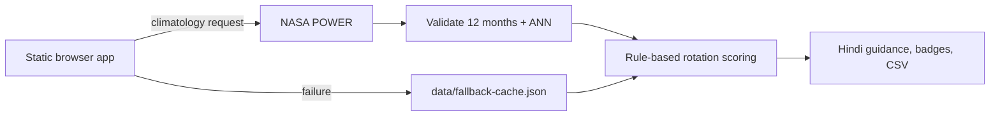

# Blaze Field Advisor

[](https://github.com/spartanfromk-18/Blaze-NSA/actions/workflows/ci.yml)

**Live demo:** https://spartanfromk-18.github.io/Blaze-NSA/

## 30-second pitch

Blaze Field Advisor is a Hindi-first, mobile-first field guidance demo. It compares four crop rotations using transparent, rule-based signals from NASA POWER climate normals, labels live versus Sample data, and keeps an offline fallback. It advises rather than commands; local agronomists and farmer context remain essential.

Hindi-first, mobile-first field guidance using NASA POWER climate normals. Open `index.html` from a static host; there is no build step and no dependency install.

## Run

Serve this directory over HTTP (ES modules and the NASA request require a browser origin):

```sh
python3 -m http.server 8080
```

Open `http://localhost:8080`. Choose a district, select priorities, and open a rotation for evidence and Hindi voice. If NASA POWER times out, the app remains usable with `data/fallback-cache.json` and shows `Sample`.

## Verify

```sh
node --test test/*.test.mjs
node scripts/verify.mjs
```

Scoring is a transparent heuristic, not machine learning or agronomic advice. NASA POWER climatology values are long-term averages; local soil, irrigation, pests, prices and farmer goals still require an expert.

## Architecture and data flow



ASCII fallback: `Browser -> NASA POWER -> validation -> scoring -> UI`; on failure, `Browser -> fallback cache -> validation -> scoring -> UI`.

No backend, accounts, cookies, storage, analytics, runtime dependencies, or secrets are used. Pages deployment copies only the app shell, source, data, and public assets into `_site/`.

## Security

The page uses a self-only meta CSP, input validation, a relative-path-only static artifact, and no third-party scripts. GitHub Pages cannot set HTTP headers, so `frame-ancestors`, `X-Frame-Options`, HSTS, and `Permissions-Policy` cannot be enforced; meta CSP also cannot enforce `frame-ancestors` or `report-uri`. HTTPS is enforced by Pages. See [SECURITY.md](./SECURITY.md) and [THREAT-MODEL.md](./THREAT-MODEL.md).

## Limitations

Curated crop-water/soil/income tables are approximations needing agronomist review; MERRA-2 climatology (2001–2025) is a regional normal, not field-level or live weather; scoring is rule-based, **not ML**; income index is illustrative; single demo region; Hindi voice depends on device voices; no soil/imagery data yet.

## Next steps

24 h caching proxy for POWER responses; GPM IMERG (rain extremes), SMAP (soil moisture), MODIS NDVI (vegetation stress), GRACE (groundwater) via Earthdata; TypeScript + Vite once code grows; agronomist-reviewed crop tables; more districts; opt-in saved priorities (no PII); monitoring.

## Acknowledgements and licence

Data attribution and POWER referencing language are recorded in [DATA-CARD.md](./DATA-CARD.md). This project is released under the MIT licence in [LICENSE](./LICENSE).
