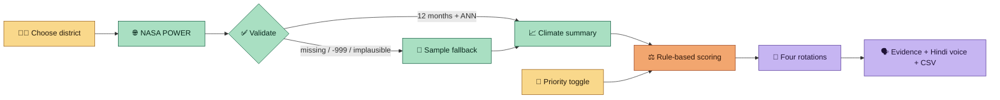

<div align="center">


# 🌾 Blaze Field Advisor

### सही फसल · सही फैसला

**A colorful, Hindi-first field advisor for better crop-rotation conversations.**

[](https://spartanfromk-18.github.io/Blaze-NSA/)
[](https://github.com/spartanfromk-18/Blaze-NSA/actions/workflows/ci.yml)
[](https://power.larc.nasa.gov/)
[](./LICENSE)

<br>

<a href="#-try-it-in-60-seconds">Try it</a> ·
<a href="#-what-you-can-explore">Explore</a> ·
<a href="#-how-it-works">How it works</a> ·
<a href="#-trust-the-labels">Trust the labels</a> ·
<a href="#-project-docs">Read the docs</a>

</div>

<br>

> **Advice, not orders.** Blaze makes transparent comparisons from climate normals. It does not replace a local agronomist, soil test, irrigation plan, market check, or farmer judgment.

## ✨ Why this project?

Farm decisions are local, but climate data is often difficult to interpret. Blaze turns NASA POWER climatology into a calm, visual starting point:

| 🌧️ Climate signal | 🌱 Rotation comparison | 🧭 Honest guidance |
|---|---|---|
| Temperature, rainfall, monsoon and heat-stress summaries | Four curated rotations with visible component scores | Every number is labelled `Live` or `Sample` |

<details>
<summary><strong>🎬 The 30-second story</strong></summary>

Choose a district → choose what matters most → compare four rotations → open the evidence → listen in Hindi if your device supports it.

If NASA POWER is unavailable, the app remains usable with a captured fallback and clearly switches to `Sample`. No fake live data, no account, no backend, no analytics.

</details>

## 🚀 Try it in 60 seconds

### 1. Open the live demo

<a href="https://spartanfromk-18.github.io/Blaze-NSA/"><strong>👉 Launch Blaze Field Advisor</strong></a>

### 2. Explore the flow

1. Pick a district.
2. Toggle **water**, **soil**, or **income** priorities.
3. Compare the ranked crop rotations.
4. Open a rotation for evidence and Hindi voice.
5. Expand **Data provenance** or download the 12-month CSV.

### 3. Run it locally

```bash
git clone https://github.com/spartanfromk-18/Blaze-NSA.git
cd Blaze-NSA
python3 -m http.server 8080
```

Open <http://localhost:8080>. A static server is required because the browser uses ES modules and NASA POWER requests.

<details>
<summary><strong>✅ Verify the project</strong></summary>

```bash
node --test
node scripts/verify.mjs
```

There is no build step and no runtime dependency install.

</details>

## 🎨 What you can explore

<table>
<tr>
<td width="25%" align="center"><h3>🌦️</h3><strong>Climate chart</strong><br><sub>12 rainfall bars, temperature line, monsoon band, heat threshold</sub></td>
<td width="25%" align="center"><h3>📊</h3><strong>Transparent scoring</strong><br><sub>Water, soil, climate-fit and illustrative income components</sub></td>
<td width="25%" align="center"><h3>🗣️</h3><strong>Hindi voice path</strong><br><sub>Visible transcript plus device voice support when available</sub></td>
<td width="25%" align="center"><h3>📥</h3><strong>Portable evidence</strong><br><sub>Provenance panel and a 12-row CSV download</sub></td>
</tr>
</table>

## 🧠 How it works



<details>
<summary><strong>🔍 The scoring rule</strong></summary>

Each component is bounded from `0–100`. A selected priority gets a `1.5×` weight; other priorities stay at `1×`. The app shows the component scores and evidence instead of hiding them behind a model label.

This is a transparent heuristic, **not machine learning**.

</details>

## 🏷️ Trust the labels

| Label | Meaning |
|---|---|
| <code>Live · NASA POWER</code> | The browser received and validated a NASA POWER response. |
| <code>Sample</code> | The app is using its captured fallback or an illustrative curated value. |

The validator rejects missing keys, non-finite values, NASA `-999` fill values, and implausible ranges. See [DATA-CARD.md](./DATA-CARD.md) for units, baseline, resolution, and attribution.

## 📚 Project docs

<details>
<summary><strong>🧭 Choose a document</strong></summary>

| Document | Use it for |
|---|---|
| [DATA-CARD.md](./DATA-CARD.md) | NASA POWER source, units, baseline, gaps, and acknowledgement |
| [MODEL-CARD.md](./MODEL-CARD.md) | Inputs, formula, weights, biases, and safe use |
| [THREAT-MODEL.md](./THREAT-MODEL.md) | Trust boundaries, threats, mitigations, residual risk |
| [SECURITY.md](./SECURITY.md) | Reporting security concerns |
| [ACCESSIBILITY.md](./ACCESSIBILITY.md) | Accessibility approach and verification status |
| [PRIVACY.md](./PRIVACY.md) | Data, cookies, analytics, and browser storage policy |
| [TASKS-HARDEN.md](./TASKS-HARDEN.md) | Production-hardening audit and evidence |
| [PROGRESS.md](./PROGRESS.md) | Implementation progress and verification history |

</details>

## 🔐 Security and privacy

The app has no backend, accounts, cookies, local storage, analytics, secrets, or runtime dependencies. It uses a self-only meta CSP, payload validation, a local fallback, and an allow-listed Pages artifact.

GitHub Pages cannot enforce response headers such as `frame-ancestors`, `X-Frame-Options`, HSTS, or `Permissions-Policy`. See [SECURITY.md](./SECURITY.md) and [THREAT-MODEL.md](./THREAT-MODEL.md).

## 🌱 Limitations

Curated crop-water/soil/income tables are approximations needing agronomist review; MERRA-2 climatology (2001–2025) is a regional normal, not field-level or live weather; scoring is rule-based, **not ML**; income index is illustrative; single demo region; Hindi voice depends on device voices; no soil/imagery data yet.

## 🛣️ Next steps

24 h caching proxy for POWER responses; GPM IMERG (rain extremes), SMAP (soil moisture), MODIS NDVI (vegetation stress), GRACE (groundwater) via Earthdata; TypeScript + Vite once code grows; agronomist-reviewed crop tables; more districts; opt-in saved priorities (no PII); monitoring.

## 🙏 Acknowledgements

Climate data comes from [NASA POWER](https://power.larc.nasa.gov/). The data acknowledgement and reference wording are documented in [DATA-CARD.md](./DATA-CARD.md).

<div align="center">

<br>

**Built for clearer climate conversations in the field.**

<br>

<a href="https://spartanfromk-18.github.io/Blaze-NSA/">🌾 Open the live advisor →</a>

</div>
